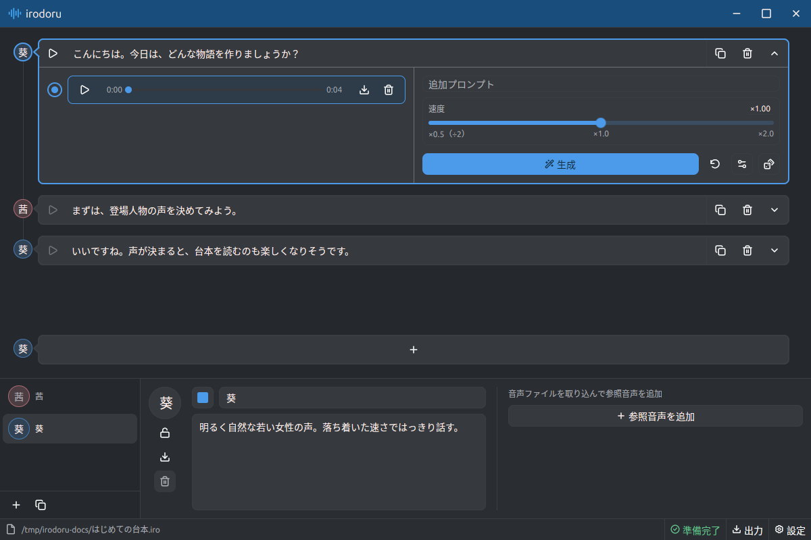

# irodoru

[Irodori-TTS](https://github.com/Aratako/Irodori-TTS) を使用した音声合成アプリです。[使い方はこちらを参照してください。](docs/Usage.md)

[Docker Server Usage](docs/Docker.md) / [Development Guide](docs/Dev.md)

## インストール

[Github Release](https://github.com/kanade-k-1228/irodoru/releases) からご自身の OS 向けのパッケージをダウンロードしてください。初回起動時に約 3.5 GBのモデルをダウンロードしますのでご注意ください。

<b>Windows:</b> zip を展開し `irodoru.exe` を起動します

- OS: Windows 11 24H2 移行
- CPU: x86_64

Windows 11 24H2（ビルド26100）以降のx64環境が必要です。CPU用ONNX Runtimeは実行ファイルに静的リンクされているため、CPUでの利用に追加ランタイムは不要です。GPU/NPUを使う場合は、**Windows App SDK Runtime 2.xの2.6.5以降**と対応ドライバーをインストールします。Windows MLが実行プロバイダーを管理し、初回にダウンロードする場合があります。Windows MLを使えない場合や、自動選択したアクセラレーターで処理できない場合はCPUに切り替わります。アプリにはランタイムDLLを同梱しません。[Windows MLの設定](docs/Dev.md#windows-ml-runtime)も参照してください。

<b>macOS:</b> DMG を開きダウンロードしたアプリを「アプリケーション」にコピーします。

- OS: macOS 15 以降
- CPU: Apple Silicon (arm64)
- Accelerator: Core ML

Core ML が CPU / GPU / Neural Engine を自動選択します。追加ランタイムは不要です。未対応の演算は CPU で実行され、自動選択時に Core ML の読み込みや実行が失敗した場合も CPU へ切り替わります。

<b>Linux:</b> deb をインストールするか AppImage に実行権限を付けて起動します。

- OS: Ubuntu 26.04 は動作確認済み
- CPU: amd64

デスクトップアプリの推論は標準で CPU を使用します。

## はじめかた

1. 左下のファイルアイコンをクリックし「新規プロジェクト…」から `.iro` ファイルを作成します。
2. キャラクター一覧の **＋** を押し、名前と声の特徴を入力します。
3. キャラクターを選び、台本末尾の **＋** からセリフを追加します。
4. セリフ右端の開閉ボタンで詳細を開き、「生成」を押します。
5. テイクの再生ボタンで確認し、ダウンロードアイコンからWAVを保存します。複数のセリフは右下の「出力」でまとめて書き出せます。

## ライセンス

アプリ本体は [MITライセンス](LICENSE) です。

依存ライブラリ、モデル、ランタイムにはそれぞれの利用条件があります。配布パッケージの `licenses/` には、ライセンス本文、著作権表示、MPL対象のソースアーカイブや入手先を含めています。

別途インストールするWindows MLと実行プロバイダーには、Microsoftや各提供元の条件が適用されます。

使用モデルは [phasefield-audio/Irodori-TTS-v4.1-Anime](https://huggingface.co/phasefield-audio/Irodori-TTS-v4.1-Anime) です。基盤モデルの[利用制限](https://huggingface.co/Aratako/Irodori-TTS-v4.1-Small#ethical-restrictions)を引き継ぎます。同意のないなりすましや、人を欺く音声の生成には使わないでください。

各モデルとコーデックに `LICENSES.txt` を同梱しています。出典と確認内容は [licenses/model/NOTICE.txt](licenses/model/NOTICE.txt) を参照してください。
