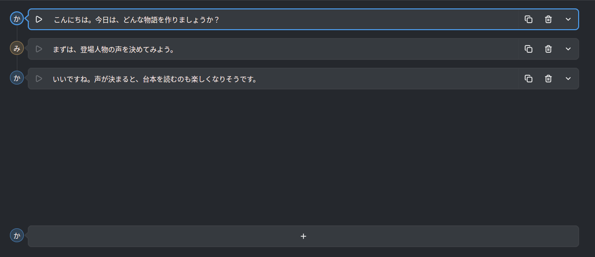
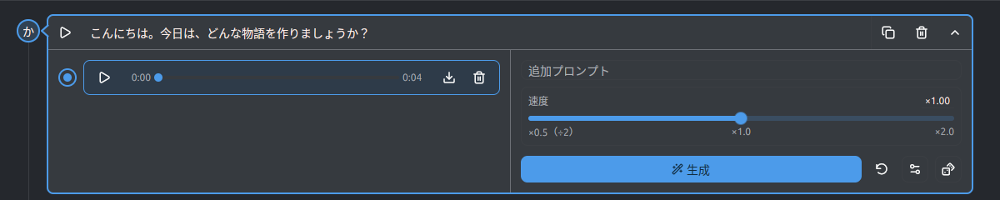
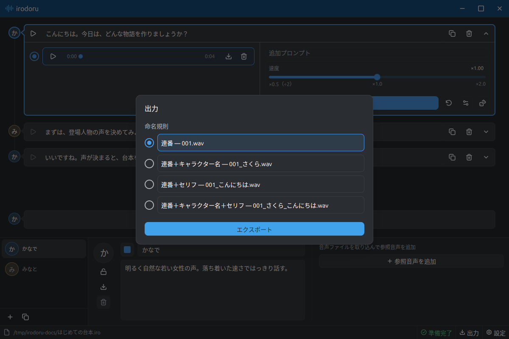
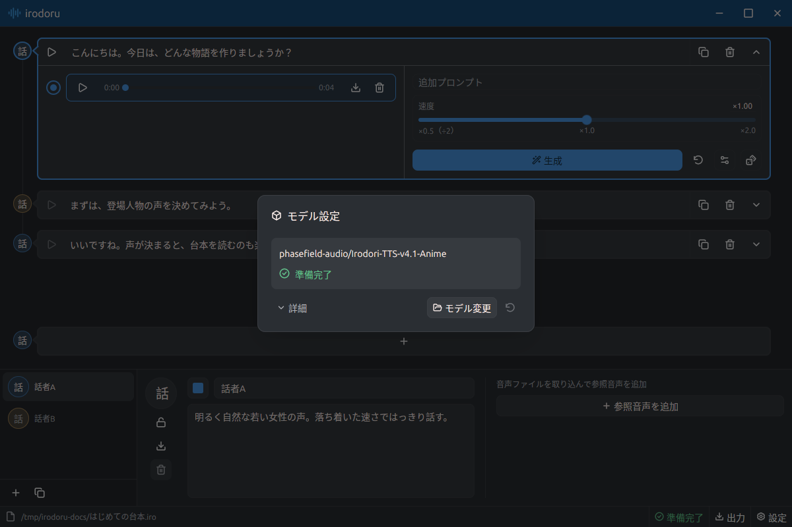

# 使い方

## 0. 画面の見方

- **上側:** セリフを並べて、音声を生成・再生します。
- **下側:** キャラクターを選び、名前や声の特徴を設定します。
- **一番下:** プロジェクトの操作、モデルの状態確認、音声の出力、設定を開きます。

## 1. プロジェクトを作る

左下のファイルアイコンを押し、「新規プロジェクト…」から保存先と名前を決めます。

台本やキャラクター、音声は1つの `.iro` ファイルに自動保存されます。続きから作業するときは「プロジェクトを開く…」で読み込んでください。

## 2. キャラクターを作る

左下の **＋** を押し、名前と声の特徴を入力します。「明るくはっきりした声」など、話し方を言葉で指定できます。名前の左で色を、アイコンを押して画像を変更できます。

声の見本を使う場合は、右側の「参照音声を追加」からWAVやMP3などを取り込みます。1秒以上の音声が必要で、60秒を超える場合は先頭60秒を使います。追加した音声はすべて使われます。

声の確認は、次の手順でセリフを生成して行います。セリフで使っているキャラクターは削除できません。

## 3. 台本を書く

1. 下の一覧から、話すキャラクターを選びます。
2. 台本の下にある **＋** を押し、セリフを入力します。改行は `Shift+Enter` です。
3. 別のキャラクターのセリフも同じ手順で追加します。

順番を変えるには、セリフ左側のアイコンをドラッグします。行の右側には複製と削除のボタンがあります。

## 4. 音声を生成して聴く

1. セリフ右端の開閉ボタンで詳細を開き、「生成」を押します。
2. 左側に音声が追加されたら、再生ボタンで聴いてみます。
3. 声の調子を変えたいときは「追加プロンプト」や「速度」を調整し、もう一度生成します。

生成した音声は「テイク」として残ります。左の丸いボタンで、使いたいテイクを選んでください。

## 5. 音声を保存する

**1つだけ保存する場合:** テイクのダウンロードアイコンを押すと、WAVファイルを保存できます。

**台本をまとめて保存する場合:** 各セリフで使いたいテイクを選び、右下の「出力」を押します。ファイル名の付け方を選び、「エクスポート」から保存先フォルダを指定すると、セリフごとのWAVが台本順に書き出されます。

## 6. モデルの状態を確認する

画面下の表示が「準備完了」になれば、音声を生成できます。初回はモデルのダウンロードと読み込みが終わるまでお待ちください。

状態表示を押すと「モデル設定」が開きます。エラーが出たときは再試行アイコンを押してください。「詳細」で詳しい状況を確認できます。別のモデルを使う場合は「モデル変更」から対応するモデルZIPを選びます。

## 7. 見た目を変える

右下の歯車を押し、「カラーテーマ」で明るい表示と暗い表示を切り替えます。
