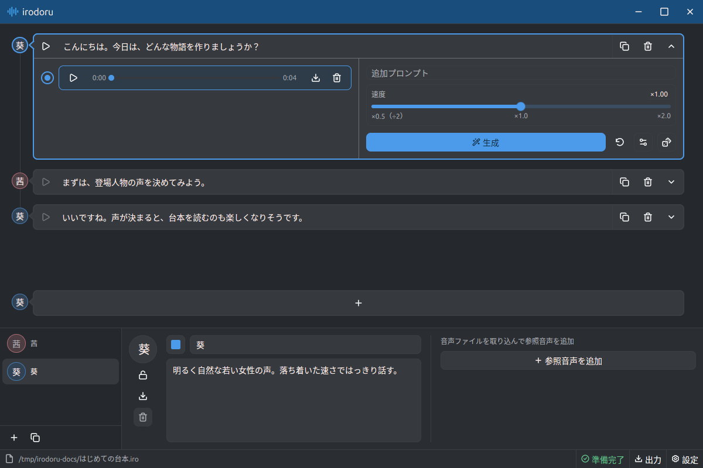
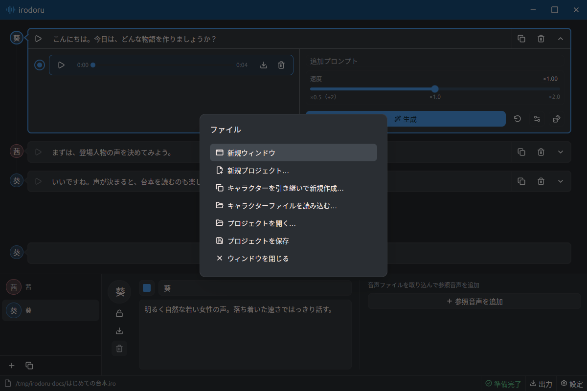
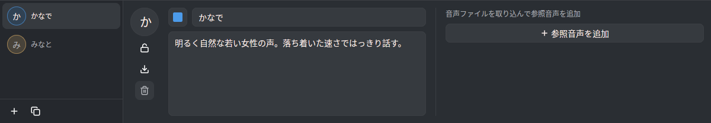
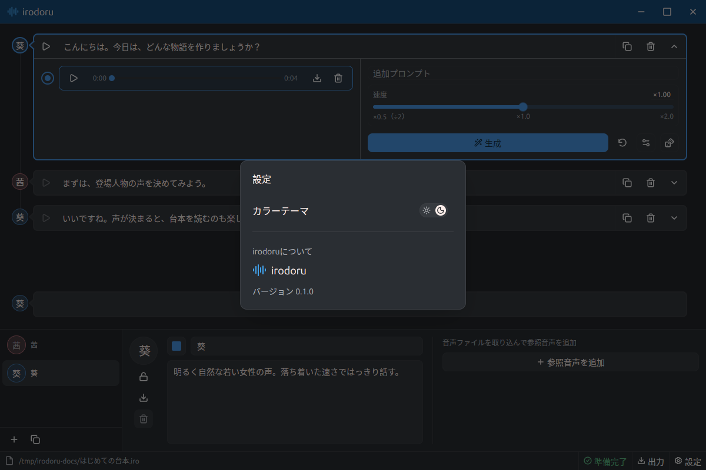

# User guide

[README](../README.md) · [Docker](Docker.md) · [Development](Dev.md)

## Projects

- Click the menu button at the far right of the footer to open the centered menu modal and create, open, or save a project. Close it with Escape, the close button, or a click on the backdrop.
- A `.iro` file contains the script, characters, reference audio, icons, and generated audio. Older `.zip` projects also work.
- Edits are saved automatically. If saving fails, use the menu's save action to retry.
- Before switching projects, save or cancel character edits and wait for generation to finish.
- Opening a `.iro` file from your OS creates a separate window. A project can be open in only one window at a time.
- On Windows, associate `.iro` files with `irodoru.exe` through **Open with**.

## Characters

1. Click **+** at the bottom left and enter a name and voice prompt, such as “a calm, clear voice.”
2. Enter sample text and generate a preview.
3. Click the save icon at the top right of the editor. Use **×** to cancel or the pencil icon to edit again.

Characters belong to their project. Optional assets:

- **Reference audio:** WAV, MP3, FLAC, Ogg Vorbis, or AAC/M4A; 1–60 seconds. Imports are converted to 48 kHz mono WAV.
- **Icon:** PNG, JPEG, WebP, GIF, BMP, TIFF, or SVG; up to 10 MB. Images are cropped to 128 × 128 pixels.

## Edit a script

- Click a character name to append a line for that character. Select a line and edit its dialogue in the lower center field.
- Hover between lines or after the last line to reveal a **+** button as wide as the dialogue field. Click it to insert an empty line there; otherwise, only the connecting line is shown.
- To move a selected line, hover over its destination gap and click **»** in the character-icon column. Use the gap before the first line to move it to the beginning. The selected line stays selected and changes are saved automatically.
- Click the selected line's trash icon to delete it and its generated audio. The last line cannot be deleted.
- Press `Enter` to add the next line or `Shift+Enter` for a line break. During Japanese input, `Enter` confirms the IME composition.

## Generate and export audio

- Select a line and generate audio. Speed ranges from **0.5× to 2.0×**; advanced settings include the seed and step count. Start with the defaults.
- Use the lower-right player to play, pause, or seek. Click its download icon to export WAV.
- Regeneration replaces existing audio only after it succeeds.
- If the first model download fails, retry it. Prepared models are reused for offline generation.

## Settings and shortcuts

Choose the color theme or open preferences from the footer menu to switch between light and dark mode.

Use `⌘` instead of `Ctrl` on macOS.

On macOS, the app uses the native menu bar and window title bar, without the custom app header. Windows and Linux retain the custom header.

- New window: `Ctrl+Shift+N`
- New project: `Ctrl+N`
- Open project: `Ctrl+O`
- Save project: `Ctrl+S`
- Preferences: `Ctrl+,`
- Close window: `Ctrl+W`

Click the project path at the bottom left for project actions: create, open, save, or close the window.

## Model settings

The model icon at the right of the footer shows preparation and download progress, readiness, or an error. Click it to open model settings, inspect the error details, or retry preparation.

To use local models, choose a folder or enter its path and click **Apply**. The folder must contain both `anime/manifest.json` and `codec/codec.json`. The selection is saved for future launches and shared across windows. **Restore default** returns to automatic model resolution (including development overrides). Model folders can be changed when preparation and generation are idle.
