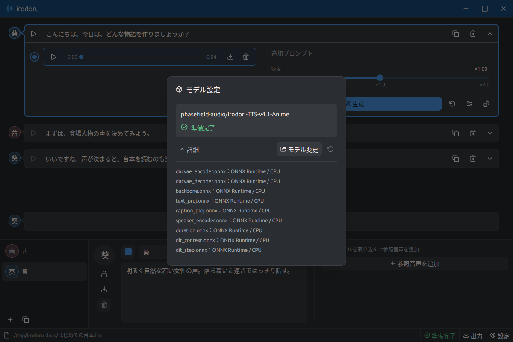

# 使い方

[概要](../README.md) · [Docker](Docker.md) · [開発ガイド](Dev.md)

## プロジェクト

- フッター左端のファイルアイコンとパスをクリックすると「ファイル」が開きます。未選択時は赤いスラッシュ付きファイルアイコンと「プロジェクト未選択」を表示します。
- 「ファイル」ではプロジェクトの新規作成、読み込み、保存、新規ウィンドウの作成、ウィンドウを閉じる操作ができます。モーダルは `Esc` または背景のクリックで閉じます。
- `.iro` ファイルには台本、キャラクター、アイコン、参照音声、生成音声をまとめて保存します。対応するプロジェクト形式は `.iro` のみです。
- 編集内容は自動保存されます。保存に失敗した場合は「プロジェクトを保存」で再試行してください。プロジェクトの切り替えは、生成と保存が終わってから行います。
- 「キャラクターを引き継いで新規作成…」を使うと、キャラクター、アイコン、各キャラクターの参照音声をコピーし、空の台本で新しいプロジェクトを作成できます。元のプロジェクトは残ります。
- OSから `.iro` を開くと別ウィンドウで表示します。同じプロジェクトを複数のウィンドウで同時に開くことはできません。Windowsでは「プログラムから開く」で `irodoru.exe` に関連付けられます。

## キャラクター

1. 左下のキャラクター一覧の **＋** を押し、名前と声の特徴を入力します。声の特徴は「落ち着いた、はっきりした声」などで指定します。
2. 編集欄の左にはアイコン、ロック、書き出し、削除の操作、中央には色・名前・声の特徴、右には参照音声があります。カラーピッカーは名前の左側です。
3. 声を試すときは、そのキャラクターのセリフを追加して生成します。キャラクター編集専用のサンプル生成はありません。

キャラクター編集欄の高さは固定です。ウィンドウの高さを変えると、上の台本領域が伸び縮みします。

一覧下部の複製ボタンで、選択中のキャラクターの設定とアイコンをコピーできます。名前には ` - 1` など重複しない接尾辞が付きます。セリフで使用中のキャラクターは削除できません。先にセリフを削除するか、別のキャラクターへ割り当ててください。

ロック中は設定を確認できますが、変更はできません。音声の再生は可能です。ロックはそのウィンドウのキャラクター編集欄だけに適用され、プロジェクトには保存されません。セリフの編集も妨げません。

### 参照音声とアイコン

- **参照音声:** WAV、MP3、FLAC、Ogg Vorbis、AAC/M4Aなどに対応します。1秒以上の音声が必要で、60秒を超える場合は先頭60秒を使います。一覧末尾の「参照音声を追加」から複数ファイルをまとめて取り込めます。取り込み時に48 kHz・モノラルのWAVに変換します。
- アップロードした参照音声はすべて自動で使います。使用する音声を選択する操作はありません。モデルの参照時間の上限を複数の録音で分け合います。
- 参照音声とテイクには共通の再生・一時停止・シーク・時間表示・WAV保存・削除の操作があります。選択ボタンがあるのはテイクだけです。参照音声の行にマウスを重ねるとファイル名を確認できます。
- 削除は現在のキャラクターの参照一覧だけに反映され、他のキャラクターのコピーや共有音声は残ります。生成したテイクを新しい参照音声として再利用する操作はありません。以前から割り当て済みの参照音声は引き続き使えます。
- **アイコン:** PNG、JPEG、WebP、GIF、BMP、TIFF、SVGに対応し、上限は10 MBです。取り込んだ画像は正方形に切り抜き、128 × 128ピクセルで保存します。

キャラクター編集欄の書き出しボタンで、設定・アイコン・参照音声を `.irochar` に保存できます。「ファイル」の「キャラクターファイルを読み込む…」で別のプロジェクトへ追加できます。台本や無関係なテイクは含みません。

## 台本を編集する

- キャラクターを選び、台本末尾の **＋** でセリフを追加します。この追加行は常に台本領域の下部に表示されます。
- セリフをクリックすると、その場で文章を編集できます。`Shift+Enter` で改行します。`Enter` では行を追加しません。日本語入力中の `Enter` は変換の確定に使います。
- セリフ右側の複製ボタンは直下に行を複製し、削除ボタンはその行を削除します。最後の1行も削除できます。複製では文章・キャラクター・生成設定を引き継ぎ、生成音声は共有しません。
- 一番右の開閉ボタンで、そのセリフの詳細を表示・非表示にします。文章を選ぶだけでは詳細は開きません。同時に開ける詳細は1行分で、別の行を選ぶと閉じます。
- キャラクターのアイコンをドラッグすると行を並べ替えられます。挿入先は全幅の背景色で示します。上下端に近づけると台本がスクロールします。
- セリフ左端の再生ボタンで、その行の選択中テイクを再生・一時停止できます。音声がない場合は無効です。

## 音声を生成する

1. セリフ右端の開閉ボタンで詳細を開きます。左側がテイク一覧、右側が生成設定です。
2. 必要に応じて追加プロンプトや速度を調整し、「生成」を押します。速度は **0.5倍〜2.0倍**です。詳細設定ではシード、ステップ数、CFGなどを調整できます。
3. 生成が成功すると新しいテイクが選択されます。過去のテイクも残るため、選択を切り替えて比較できます。

「生成」のすぐ右のリセットアイコンで生成設定を既定値に戻します。サイコロのボタンはシードを変えて再生成します。生成を止める場合は「停止」を押します。実行中のテイクが終わってから停止します。

テイクの選択はプロジェクトに保存されます。テイクを選ぶと、その生成時の文章、追加プロンプト、編集可能な生成設定が復元されます。WAVのメタデータにはシード、ステップ数、速度、CFG、モデル、文章、プロンプト、参照音声の情報を保存します。

## WAVを書き出す

テイクのダウンロードアイコンで、個別のWAVを保存できます。キャラクターが持つ参照音声は独立したコピーなので、元のテイクを削除しても既存の参照音声は残ります。

複数のセリフをまとめて保存するときは、フッターの「出力」を押します。命名規則を選び、「エクスポート」を押して保存先フォルダを指定してください。

命名規則は連番、連番＋キャラクター、連番＋セリフ、連番＋キャラクター＋セリフから選べます。選択中テイクに記録されたキャラクター名と文章を使い、使えないファイル名文字は置換し、長い名前は短縮します。保存先には `irodoru-export` フォルダを作り、重複時は連番を付けます。各行の選択中テイクを台本順に書き出します。音声が未選択の行がある場合は、書き込み前に行番号を表示します。

書き出したWAVには生成条件が残ります。再度取り込んだときも情報を保持します。

## モデル設定

フッターのモデル表示はエンジンの状態を示します。クリックすると「モデル設定」が開きます。

| 表示 | 状態 |
| --- | --- |
| 緑のチェック | 準備完了 |
| 青のスピナー | 音声生成中 |
| 赤の警告 | モデルエラー |
| 黄のスピナー | 確認・展開・読み込み中 |
| 青のダウンロードアイコンと進捗率 | ダウンロード中 |

読み込み後は、モデルファイルの `checkpoint` に記録された `ユーザー名/リポジトリ名` を表示します。通常は `phasefield-audio/Irodori-TTS-v4.1-Anime` です。

左側の「詳細」で、各処理の実行プロバイダー、ダウンロードなどの処理量、エラーの詳細を確認できます。情報が長い場合はスクロールします。実行プロバイダーの表示は処理単位の選択先であり、すべての演算がGPU/NPUで動くことを保証しません。

右側の「モデル変更」から、対応するモデルZIPを取り込めます。ZIPには `anime/manifest.json` と `codec/codec.json` を含む必要なモデル一式が必要です。検証してアプリの保存領域へ展開するため、取り込み後の元ZIPは移動・削除できます。設定はすべてのウィンドウと次回起動に反映されます。リセットアイコンで既定のモデル解決順序へ戻します。モデル変更は準備・生成が終わってから行います。

エラー時は状態表示の右にある再試行アイコンを押してください。ダウンロード中は進捗バーを表示し、準備済みのモデルはオフラインでも再利用できます。

## 設定とショートカット

フッター右端の歯車を押すと「設定」が開きます。カラーテーマの切り替えとアプリ情報の確認ができます。

| 操作 | ショートカット |
| --- | --- |
| 新規ウィンドウ | `Ctrl+Shift+N` |
| 新規プロジェクト | `Ctrl+N` |
| プロジェクトを開く | `Ctrl+O` |
| 保存 | `Ctrl+S` |
| 設定 | `Ctrl+,` |
| ウィンドウを閉じる | `Ctrl+W` |

macOSでは `Ctrl` の代わりに `⌘` を使います。macOSは標準のメニューバーとタイトルバーを使用し、WindowsとLinuxはアプリ独自のヘッダーを表示します。

ウィンドウの位置・大きさ・最大化・全画面の状態は、閉じるときに保存します。次回起動時に接続中のディスプレイへ収まる場合は復元し、それ以外は960 × 700で中央に開きます。追加のウィンドウはGPUIの標準配置で開きます。

対応するプロジェクトは現在の形式（バージョン0、音声は単一のWAV）のみです。旧形式の自動変換はありません。
