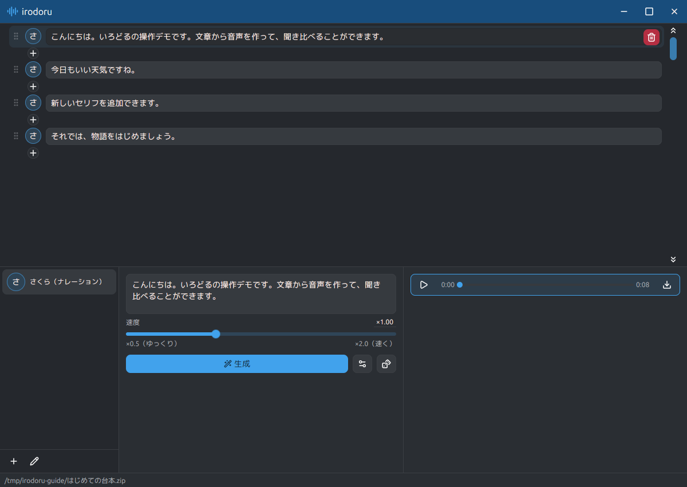
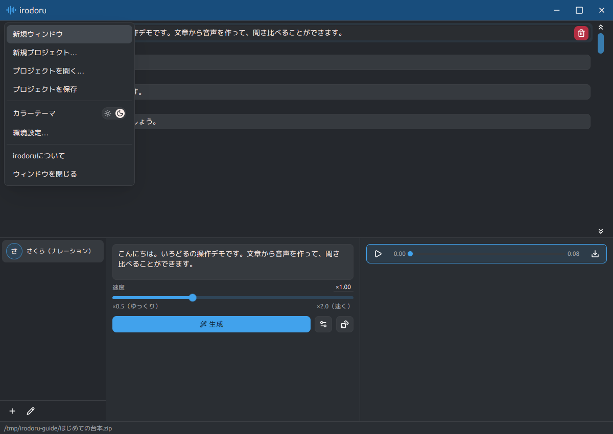
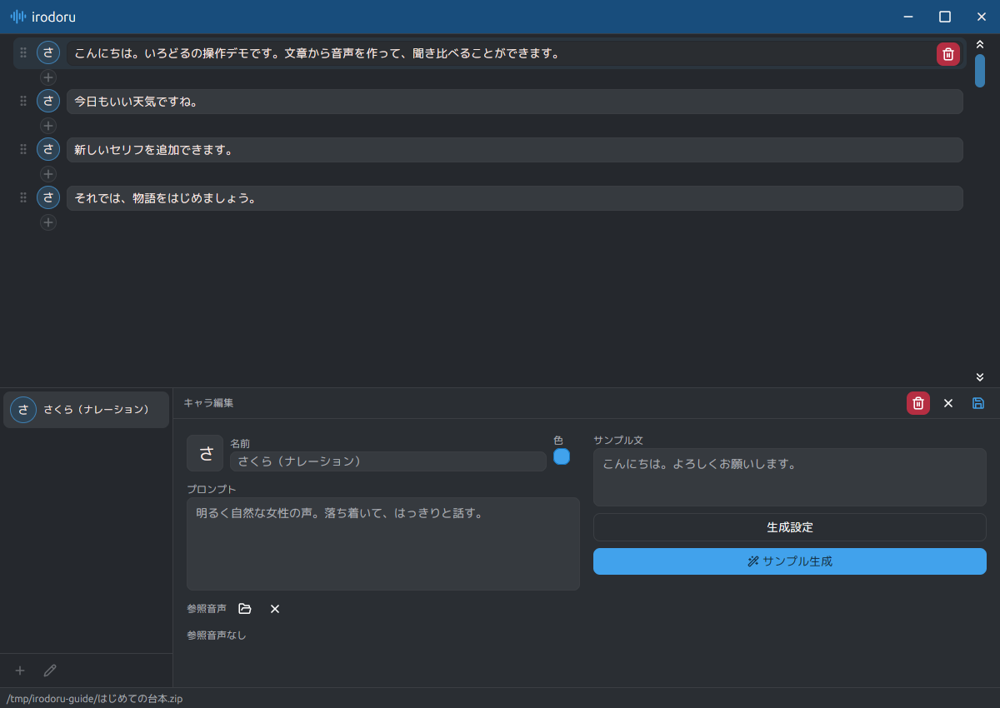
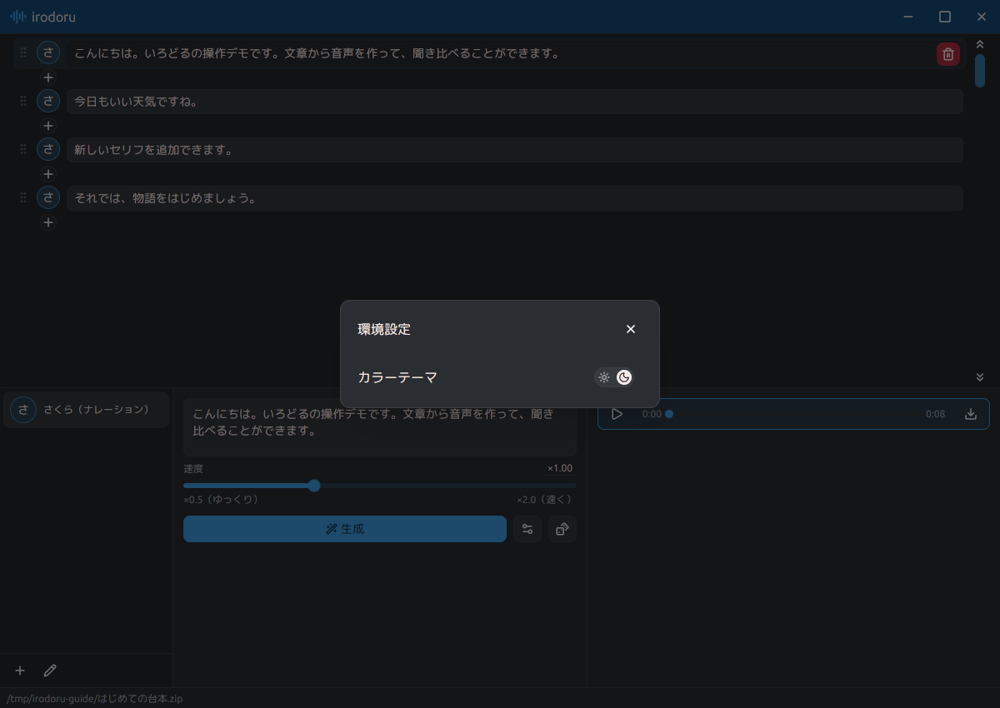

# irodoru の使い方

irodoru は、キャラクターの声で台本を読み上げるアプリです。
まずはキャラクターを用意し、セリフを入力して「生成」を押してみましょう。

画面上部が台本、左下がキャラクター一覧、中央下がセリフの編集・生成、右下が生成した音声です。
以下のスクリーンショットは、サンプルの台本を開いた実アプリの画面です。

## 1. プロジェクトを作る・開く

左上の **irodoru** をクリックするとメニューが開きます。

- 初めて使うときは「新規プロジェクト…」を選び、ZIP ファイルの保存先と名前を決めます。
- 続きから作業するときは「プロジェクトを開く…」で保存した ZIP を選びます。

台本・キャラクター・音声は、この ZIP にまとめて保存されます。

## 2. キャラクターを用意する

1. 左下のキャラクター一覧の下にある「＋」を押します。
2. 名前と「プロンプト」を入力します。プロンプトには、例えば「明るく自然な女性の声。落ち着いて、はっきりと話す。」のように声の特徴を書きます。
3. 「サンプル文」を入力し、「サンプル生成」で声を試せます。
4. 編集欄の右上にある保存アイコンを押して確定します。

アイコン画像・色・参照音声も設定できます。既存のキャラクターを編集するときは、左下の鉛筆アイコンを押します。編集を取り消すときは、編集欄右上の「×」を押します。

## 3. 台本を書く

左下のキャラクター名をクリックすると、そのキャラクターの新しい行が台本の末尾に追加されます。
台本の行を選び、中央下の入力欄でセリフを編集します。

- **行を追加：** 行と行の間、または台本末尾の「＋」を押すと、その位置に空の行が入ります。
- **並べ替え：** 行の左端にある点のハンドルをドラッグします。
- **行を削除：** 選択した行の右端にあるゴミ箱を押します。最後の1行は削除できません。
- **入力中の操作：** `Enter` で次の行を追加し、`Shift+Enter` で同じセリフ内に改行を入れます。日本語変換中の `Enter` は変換の確定に使います。

台本の行数に上限はありません。

## 4. 音声を生成して保存する

1. 台本から生成したい行を選び、「生成」を押します。起動直後はモデルの読み込みが終わるまでお待ちください。
2. 完了すると右下に音声プレーヤーが表示されます。再生ボタンで再生・一時停止、バーで再生位置を変更できます。
3. プレーヤー右端のダウンロードアイコンから、音声を WAV ファイルとして保存できます。

「速度」で話す速さを **×0.5〜×2.0** の範囲で調整できます。×1.0 が標準で、×0.5 はゆっくり、×2.0 は速く話します。「生成」の右にある詳細設定ボタンからは、シードやステップ数などを変更できます。最初は既定の設定で試してください。

台本の変更は自動保存されます。手動で保存するときは、左上のメニューから「プロジェクトを保存」を選びます。保存エラーが表示された場合も、同じ操作で再試行できます。
キャラクター編集中は保存またはキャンセルしてから、生成中は処理が終わってからプロジェクトを切り替えたり終了したりしてください。

## 5. カラーテーマを変える

左上のメニューの「カラーテーマ」で、明るい表示と暗い表示を切り替えられます。
「環境設定…」からも同じ操作ができ、選んだテーマは次回起動時にも使われます。

## よく使うショートカット

macOS では、表の `Ctrl` を `⌘` に読み替えてください。

| 操作 | キー |
| --- | --- |
| 新規プロジェクト | `Ctrl+N` |
| プロジェクトを開く | `Ctrl+O` |
| プロジェクトを保存 | `Ctrl+S` |
| 環境設定を開く | `Ctrl+,` |
| ウィンドウを閉じる | `Ctrl+W` |
